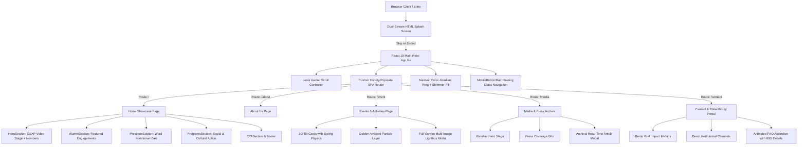

# 🏛️ FACES — Friends of Alumni/Ae of Colleges Educational Institutes & Schools

<div align="center">

[](https://react.dev/)
[](https://www.typescriptlang.org/)
[](https://vitejs.dev/)
[](https://tailwindcss.com/)
[](https://www.framer.com/motion/)
[](https://greensock.com/gsap/)
[](https://lenis.darkroom.engineering/)
[](https://vercel.com/)

<br />

<p align="center">
  <strong>✦ Shaping Leaders. Building Legacies. Uniting Alumni Across Generations. ✦</strong>
</p>

<p align="center">
  A high-performance, cinematic web platform for <strong>FACES</strong> — Kolkata's premier non-profit umbrella association uniting alumni across multidisciplinary schools and colleges for social empowerment, philanthropy, cultural enrichment, and educational advancement.
</p>

---

[Key Highlights](#-key-highlights) •
[Architecture](#-system-architecture) •
[Interactive Features](#-interactive-features--pages) •
[Design System](#-design-system--aesthetics) •
[Getting Started](#-getting-started) •
[Directory Structure](#-repository-structure) •
[Performance](#-performance--asset-optimization) •
[Philanthropic Governance](#-philanthropic-governance--impact)

---

</div>

<br />

## 🌟 Executive Summary

**FACES** (*Friends of Alumni/Ae of Colleges Educational Institutes & Schools*) was established in **2006** and formally chartered in **2007** under the leadership of President **Imran Zaki**. Headquartered in Bowbazar, Kolkata, the organization serves as the apex body uniting active alumni bodies from prominent academic institutions.

Over nearly two decades, FACES has spearheaded high-impact initiatives spanning community policing (**The SAMPARK Project** with Kolkata Police), girl child advocacy (**Walk Against the Killing of Girl Child**, **Amity Half Marathon**), mobile healthcare (**Lotus Mobile Medical Bus**, delivering free medical care to 41,000+ patients), disaster relief, communal harmony dialogues, and intellectual discourse at literature festivals.

This repository hosts the **modernized official digital portal for FACES**, architected as an ultra-fluid Single Page Application (SPA) pairing **React 19**, **TypeScript**, **GSAP**, **Framer Motion**, and **Lenis Smooth Scroll** with a bespoke luxury dark-and-gold design language.

<br />

## ✨ Key Highlights

| Pillar | Technical / Architectural Feature |
| :--- | :--- |
| **🎨 Luxury Visual Identity** | Curated Deep Navy (`#0a1628`), Frosted Obsidian, and 24K Liquid Gold palettes with glassmorphic cards, sweep shimmer animations, and conic-gradient emblem accents. |
| **🚀 Instant Dual Splash Engine** | Raw DOM inline video pre-loader with real-time viewport aspect ratio detection (mobile vs. desktop video separation with immediate unmount of unused stream). |
| **⚡ Micro-Interaction Suite** | 3D cursor-tracking perspective tilt cards (`useSpring` & `useMotionValue`), GSAP blur-in typography reveals, golden particle atmospheric engine, and parallax hero stages. |
| **📱 Native Mobile Experience** | Custom fixed floating bottom pill navigation (`MobileBottomBar.tsx`) with dynamic active state indicator dots and smooth route dispatchers. |
| **📰 Immersive Media Gallery** | Archival press reader displaying historical features from *The Telegraph*, *The Times of India*, and *Metro* with modal transcription view and multi-image photo lightboxes. |
| **🛡️ Zero-Latency SPA Navigation** | Native HTML5 History API integration with customized `popstate` dispatching and seamless scroll restoration via Lenis Inertial Scroll. |
| **🏛️ Tax & Philanthropic Governance** | Dedicated contribution portal with 80G/12A Indian Income Tax Act exemption compliance details and responsive interactive FAQ accordion. |

<br />

## 📐 System Architecture

The application adopts a modular component hierarchy powered by a zero-overhead native SPA routing model and physics-driven presentation layers:



<br />

## 🔍 Interactive Features & Pages

### 1. 🎬 Cinematic Hero & Landing (`/`)
* **Dual-Track Cinematic Backdrop**: Seamless blend of ambient video loop and high-resolution photography with custom vignette overlays and noise-film texturing.
* **GSAP Blur-In Sequence**: Staggered text reveal with SVG Gaussian blur transition for eyebrow badge, primary wordmark, and narrative summary.
* **Dynamic Institutional Metrics**: Live legacy numbers showcasing `20+ Years`, `50+ Activities`, and `100+ Member Bodies`.
* **Featured Engagements (`AlumniSection.tsx`)**: Spotlights marquee milestones including Father Felix Raj’s *"Magis Mantra"* launch, winter blanket distribution, and Zara Bhardwaj’s communal harmony documentary.
* **Presidential Keynote (`PresidentSection.tsx`)**: Editorial profile of President **Imran Zaki** featuring gold offset framing, radial glow aura, and typography set in *Playfair Display*.

### 2. 📖 About FACES (`/about`)
* **Narrative Journey**: Alternating full-width editorial blocks mapping out 18+ years of societal transformation across Kolkata and West Bengal.
* **Key Milestone Cards**:
  * **The SAMPARK Project**: Landmark community policing partnership with the Kolkata Police.
  * **WB Tourism Kite Festival**: State-level cultural mobilization in 2011 and 2012.
  * **Amity Kolkata Half Marathon**: Marathon initiative championing the underprivileged girl child.
  * **Avon & Network 18 Cyclothon**: Kolkata’s premier city-wide cycling awareness event.
* **Interactive Lightbox**: Full-resolution image zoom with spring dampening upon clicking any archival photograph.

### 3. 🎟️ Events & Engagements (`/event`)
* **3D Mouse Tilt Cards**: Realistic physical cards tracking cursor coordinates via `useMotionValue` and `useSpring` with dynamic rotational shadows.
* **Golden Atmospheric Particles**: Canvas-free CSS/Framer Motion particulate system generating shimmering embers.
* **Multi-Category Tagging**: Color-coded taxonomy across `Gala`, `Summit`, `Dialogue`, `Awareness`, `Workshop`, `Sports`, and `Cultural`.
* **Deep Gallery Lightbox**: Integrated modal offering multi-photo slide carousels for each event album.

### 4. 📰 Media & Press Archive (`/media`)
* **Historical Press Clippings**: Curated news coverage from *The Telegraph*, *The Times of India*, *Metro*, and *T2*.
* **Article Reader Modal**: Clean modal overlay displaying verbatim news transcripts, estimated read times, and high-fidelity scanned prints.
* **Interactive Categorization**: Fast category filtering between Press, Interviews, and Public Outreaches.

### 5. 🤝 Philanthropy & Contact (`/contact`)
* **Bento Grid Impact Display**: High-density statistics highlighting two decades of community service and international alumni networks.
* **Direct Leadership Channels**: Contact details including phone (`+91-98310 19298`), email (`imrzak@gmail.com`), and physical registered office in Bowbazar, Kolkata.
* **Section 80G & 12A Compliance**: Explicit financial transparency declaration for donor tax benefits under the Indian Income Tax Act.
* **Framer-Motion FAQ Accordion**: Smooth height interpolation answering common donor inquiries (audits, wire transfers, recurring contributions).

<br />

## 🎨 Design System & Aesthetics

The UI follows a strict design token architecture configured in [`src/index.css`](file:///home/yash-tomar/Documents/yash/client_school_webiste2/src/index.css) and modernized through Tailwind CSS v4:

```css
:root {
  /* Primary Midnight Palette */
  --navy:            #0a1628; /* Deep Obsidian Base */
  --navy-mid:        #0f2044; /* Elevation Layer */
  --royal:           #1a3a6b; /* Accent Substrate */
  --royal-light:     #2952a3; /* Interactive Blue */

  /* Metallic Gold Spectrum */
  --gold:            #c9a84c; /* Sovereign Gold */
  --gold-light:      #e8c96e; /* Shimmer Accent */
  --gold-pale:       rgba(201, 168, 76, 0.15);

  /* Surface Neutrals & Glass */
  --off-white:       #f8f7f4;
  --glass-bg:        rgba(255, 255, 255, 0.06);
  --glass-border:    rgba(255, 255, 255, 0.12);

  /* Physics & Transitions */
  --transition-smooth: cubic-bezier(0.25, 0.46, 0.45, 0.94);
  --transition-apple:  cubic-bezier(0.22, 1, 0.36, 1);
}
```

### Typography Hierarchy
* **Display / Editorial**: `Cormorant Garamond` & `Playfair Display` — Used for regal headers, quotes, and milestone accents.
* **Interface & Body**: `Inter` — High-legibility font supporting responsive clamps (`clamp(...)`) across all viewports.
* **Branding & Accent**: `Outfit`, `Lobster`, and `Spicy Rice` for specific event banners and aesthetic sub-labels.

<br />

## 🛠️ Tech Stack & Tooling

```
┌─────────────────────────────────────────────────────────────┐
│                       FACES WEB STACK                       │
├──────────────────────┬──────────────────────────────────────┤
│ Core Framework       │ React 19.2 (Next-Gen Fiber Runtime)  │
│ Language             │ TypeScript 6.0                       │
│ Build Tool & HMR     │ Vite 8.0 with Rolldown Support       │
│ Styling Core         │ Tailwind CSS v4 + Bespoke Tokens     │
│ Motion & Physics     │ Framer Motion 12.4                   │
│ Timeline Animations  │ GSAP 3.15 (GreenSock)                │
│ Inertial Scrolling   │ Lenis 1.3                            │
│ Iconography          │ Lucide React 1.21                    │
│ 3D Mathematics       │ Three.js 0.184                       │
│ Hosting / Edge CDN   │ Vercel (Edge SPA Routing Rewrites)   │
└──────────────────────┴──────────────────────────────────────┘
```

<br />

## 🚀 Getting Started

Follow these instructions to configure and run the project locally.

### Prerequisites

Ensure you have **Node.js (v18.0 or higher)** and **npm** installed on your system.

```bash
node -v   # Should output v18.x, v20.x, or v22+
npm -v    # Should output v9.x or v10+
```

### Installation

1. **Clone the repository:**
   ```bash
   git clone https://github.com/yash12345-ctrl/FACES_website.git
   cd FACES_website
   ```

2. **Install project dependencies:**
   ```bash
   npm install
   ```

3. **Start the local development server:**
   ```bash
   npm run dev
   ```
   Open your browser and navigate to `http://localhost:5173/`.

### Available Scripts

| Script | Command | Purpose |
| :--- | :--- | :--- |
| `dev` | `npm run dev` | Launches the Vite HMR development server with instant reload. |
| `build` | `npm run build` | Runs TypeScript compilation (`tsc -b`) and generates production bundles. |
| `preview` | `npm run preview` | Locally serves the compiled production build from `/dist`. |
| `lint` | `npm run lint` | Analyzes code quality using ESLint with React Hooks rules. |

<br />

## 📁 Repository Structure

```plaintext
FACES_website/
├── public/                       # Static media, WebP imagery & videos
│   ├── v1.webp ... v29.webp      # Core branding, portraits & historical galleries
│   ├── e1.webp ... e43.webp      # Event photo archive (2015–Present)
│   ├── n1.webp, n22.webp         # Press articles & high-res backgrounds
│   ├── splash.mp4                # Mobile optimized startup splash video
│   ├── Boy_opening_letter...mp4  # Desktop high-resolution intro video
│   └── favicon.svg               # Vector brand crest
├── src/
│   ├── about/                    # About Us module
│   │   ├── about.tsx             # Narrative blocks, milestones & lightbox
│   │   └── about.css             # Page-specific styling & gold dividers
│   ├── components/               # Modular UI blocks
│   │   ├── Navbar.tsx            # Frosted glass nav with rotating conic emblem
│   │   ├── HeroSection.tsx       # Cinematic video hero with GSAP blur sequence
│   │   ├── AlumniSection.tsx     # Featured programs & historical milestones
│   │   ├── PresidentSection.tsx  # Profile & message from President Imran Zaki
│   │   ├── ProgramsSection.tsx   # Initiative showcases & book launches
│   │   ├── LegacyNumbers.tsx     # Animated counter metrics component
│   │   ├── CTASection.tsx        # Membership & engagement banner
│   │   ├── MobileBottomBar.tsx   # Floating mobile quick-navigation bar
│   │   └── Footer.tsx            # Master footer with org links & accreditation
│   ├── contact/                  # Contact & Philanthropy module
│   │   ├── contact.tsx           # Bento metrics, 80G tax details & FAQ
│   │   └── contact.css           # Grid styles & accordion animations
│   ├── event/                    # Events & Activities module
│   │   ├── event.tsx             # 3D Tilt Cards, particle FX & album lightbox
│   │   └── event.css             # Filter tags & 3D perspective rules
│   ├── media/                    # Press & Media coverage module
│   │   ├── media.tsx             # News archive, article reader modal
│   │   └── media.css             # Parallax hero & clipping layouts
│   ├── App.tsx                   # Master router, Lenis scroll orchestrator
│   ├── App.css                   # Global layout overrides & transitions
│   ├── index.css                 # Master design tokens & Tailwind imports
│   └── main.tsx                  # React 19 DOM entry mount
├── index.html                    # HTML5 template with raw pre-JS video splash
├── vite.config.ts                # Vite config with React & Tailwind plugins
├── vercel.json                   # Rewrites for seamless SPA edge routing
├── tsconfig.json                 # Master TypeScript project configuration
├── package.json                  # Dependencies & execution scripts
└── README.md                     # Comprehensive documentation
```

<br />

## ⚡ Performance & Asset Optimization

* **Zero-Delay Inline Video Preloader**: The splash screen script in [`index.html`](file:///home/yash-tomar/Documents/yash/client_school_webiste2/index.html) immediately determines whether the device is mobile or desktop, instantiating only the pertinent MP4 video stream and tearing down the alternative before JavaScript bundles finish downloading.
* **Lossless WebP Pipeline**: All graphical assets in `/public` utilize modern WebP compression, reducing asset payloads by ~65% relative to uncompressed PNG/JPEG files while preserving contrast and detail.
* **Smooth Inertial Physics**: Powered by **Lenis**, the application eliminates scroll-stutter while preserving native mouse wheel acceleration curves:
  $$\text{ease}(t) = \min(1, 1.001 - 2^{-10t})$$
* **CSS Containment & GPU Acceleration**: Heavy animated elements utilize `transform: translate3d(...)` and `backdrop-filter` isolation to ensure 60fps / 120fps fluid refresh rates.

<br />

## 🏛️ Philanthropic Governance & Impact

<div align="center">

> *"Education is the most powerful weapon which you can use to change the world."*
> 
> — Nelson Mandela *(Featured in the FACES Philosophy Block)*

</div>

FACES operates strictly under transparent non-profit governance:
* **Tax Exemption Status**: Donations made to FACES Alumni Association are exempt under **Section 80-G and 12A** of the Indian Income Tax Act, 1961.
* **Audited Transparency**: 100% of designated project allocations go towards public welfare (e.g. Student Scholarship Funds, Winter Relief Drives, and Mobile Medical Initiatives).
* **Community Inclusivity**: FACES welcomes alumni bodies regardless of background, gender, or academic discipline.

<br />

## 📞 Institutional Contacts

For partnerships, alumni affiliations, event collaborations, or philanthropic contributions:

* **Registered Office**: 93, Phears Lane, Bowbazar, Kolkata, West Bengal — 700 012, India
* **President**: Imran Zaki
* **Official Liaison**: `imrzak@gmail.com`
* **Direct Telephone**: `+91-98310 19298`
* **Website**: [www.faceskolkata.com](https://www.faceskolkata.com/)

---

<div align="center">
  <sub>Designed & Developed with precision for <strong>FACES Alumni Association</strong>. © 2006–2026 FACES. All rights reserved.</sub>
</div>
